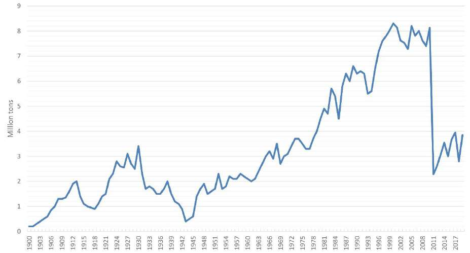
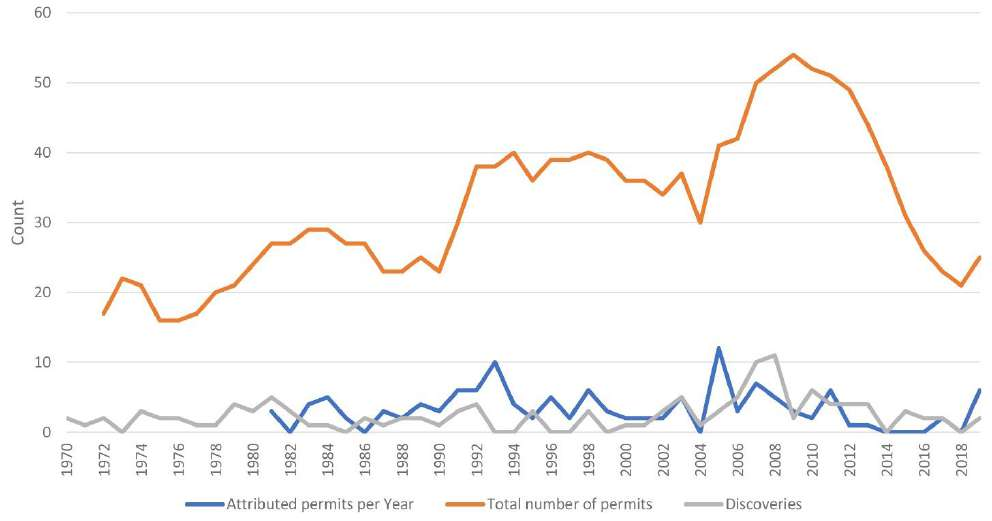
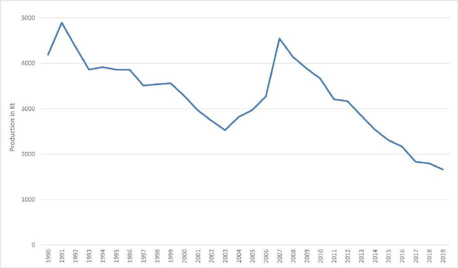
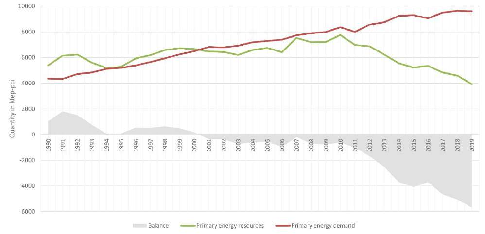
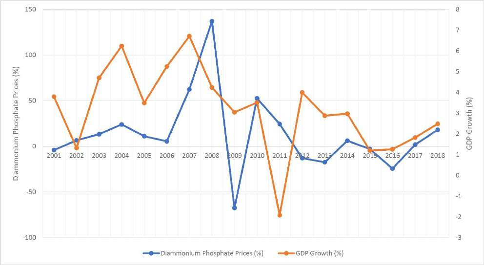



Tunisia is a small producer of oil, gas, and phosphates, yet these resources weigh heavily on its public finances, its regional politics, and its public debate. My graduation thesis at the National School of Administration (ENA) in Tunis asked one question: *how can the governance of the extractive industry in Tunisia be improved?*

The short answer is that the weakest points lay less in the legal texts than in how they were applied. Revenue management, the local impact of extraction, and the governance of state-owned enterprises scored worst, and there was a measurable gap between law and practice. This page summarizes the full report.

> [!NOTE]
> The thesis was completed in 2020. It describes the legal and institutional framework in force at that time, including the 2014 Constitution, which Tunisia replaced with a new constitution in 2022. Most data run to 2019. Read this page as a snapshot of that period.

| | |
|---|---|
| **Author** | Meher Béjaoui |
| **Institution** | National School of Administration (ENA), Tunis |
| **Year** | 2020 |
| **Supervisor** | Pr. Hassen Soukni |
| **Length** | 92 pages, plus 8 annexes |
| **Language** | English |

Download the full thesis (PDF)

## Key findings

- **Mining was governed worse than oil and gas.** In the 2017 Resource Governance Index, Tunisia scored 56 out of 100 for oil and gas (26th of 89 assessments) and 46 for mining (48th). Mining scored lower on every measure.
- **Revenue management was the weakest component.** It scored 40 for oil and gas and 30 for mining. Tunisia had no explicit fiscal rules for resource revenues and no sovereign wealth fund.
- **Local impact was the black spot.** The mining sector scored 25 out of 100 on local impact, far behind Chile (86) and Botswana (67).
- **Phosphate lost its place.** Tunisia was the world's 5th largest phosphate producer in 2010, with 4.2% of global production. By 2019 it ranked 12th, with 1.25%.
- **Most oil concessions sat outside the current code.** As of 2018, only 16 hydrocarbon concessions were governed by the 1999 Hydrocarbons Code. Another 38 were still governed by older texts, including the two most productive oil concessions.
- **Parliament arrived late.** Parliamentary approval of contracts came at the end of the process, as a single yes-or-no vote. One permit revision took about two years to pass.
- **Practice trailed the law.** The index scored Tunisia's practice 20% lower than its laws.

## Why governance matters here

Natural resource wealth does not turn into development by itself. Many resource-rich countries grow more slowly and develop less than countries with fewer resources, a pattern known as the resource curse. The thesis reads the Tunisian case through that lens.

Three features make the question pressing in Tunisia:

- **Geography.** The deposits lie mostly in interior and southern regions that already faced governance constraints and development challenges. Gafsa and its neighbors lived with the inequalities that often surround extraction sites.
- **Volatility.** Resource revenues move with commodity prices and production volumes, which makes public spending less effective when it follows them up and cannot follow them down.
- **Depletion.** The reserves are finite and modest. A country with small reserves has less time to convert them into lasting assets.

Tunisia was not a resource-dependent country in the fiscal sense. Resource revenues were about 9% of total revenue in 2018, below the 20% threshold the International Monetary Fund uses. The sector's weight in the regions where it operates, and in an economy under strain, still made its management crucial.

The thesis organizes its analysis around the **decision chain** of the Natural Resource Charter, published by the Natural Resource Governance Institute (NRGI). The chain has four stages:

1. Discovering the resource and deciding whether to extract it.
2. Getting a good deal through licensing, taxation, and contracts.
3. Managing the revenues, especially their volatility.
4. Investing those revenues for sustainable development.

The charter's central point is that the chain is only as strong as its weakest link. Strong licensing rules do little if revenue collection is weak.

## The legal framework as of 2020

### The 2014 Constitution

The constitution in force when the thesis was written gave natural resources unusual attention, a response to the economic and social grievances behind the 2011 revolution. Four articles mattered most:

- **Article 12** committed the state to exploiting natural resources in the most efficient way.
- **Article 13** declared that natural resources belong to the people of Tunisia, and required investment contracts to go before the competent parliamentary committee and agreements to be approved by the Assembly.
- **Article 15** set transparency, integrity, efficiency, and accountability as principles of public administration.
- **Article 136** allowed a portion of resource revenues to be allocated to regional development.

Article 13 was added at the last stage of drafting. It answered a specific concern: before the revolution, many agreements in the sector had been shrouded in secrecy.

The thesis notes what these articles left open. They did not give local authorities any authority over resources. They set no benefit-sharing procedure, and the regional allocation in Article 136 was optional.

### The two codes

Two codes carried most of the detail.

The **Mining Code** (Law 2003-30 of April 28, 2003) has 125 articles. It sorts mineral deposits into six groups of "mines" and treats everything else as quarries under a separate law. It replaced a 1953 decree, ended the old 99-year concessions, and added incentives on taxes, customs, and social charges.

The **Hydrocarbons Code** (Law 99-93 of August 17, 1999) has 139 articles and was amended four times, most recently in 2017. It was written to end the dispersion and inconsistency of the earlier texts. It introduced mandatory environmental impact studies, site restoration obligations, and a financial reserve for the end of exploitation.

| Title | Mining Code | Hydrocarbons Code |
|---|---|---|
| Prospecting | License for one year, renewable once | Authorization for up to one year; permit for two years, extendable by up to 12 months |
| Exploration permit | Three years, renewable twice for up to three years each, plus an exceptional renewal after a discovery | Five years at first; up to 29 years with every renewal and extension |
| Exploitation concession | Duration tied to exploitable reserves, extendable | Up to 30 years |

In hydrocarbons, every permit application must offer the national company, ETAP, an option to participate in any resulting concession. Two regimes apply: a partnership in which ETAP takes a share alongside the title holder, and a production sharing contract in which ETAP holds the title and the contractor finances the work at its own risk in exchange for a share of production.

### What the thesis found in the texts

- **Titles go to the first applicant.** Tunisia allocated titles on a first-come, first-served basis, with no competitive bidding. In mining, an applicant's technical and financial capacity was assessed without predetermined criteria.
- **The 2017 amendment aligned the code with Article 13.** Since then, the convention attached to each hydrocarbon title has been adopted by law. Before, it was adopted by decree, which was faster.
- **Old regimes survived.** The codes did not repeal earlier texts for existing titles. As of 2018, 16 concessions fell under the Hydrocarbons Code, 23 under a 1985 decree-law, and 15 under texts from 1953 and 1958. Of the ten most productive oil concessions in 2019, only one was under the code. Administrators had to apply several sets of fiscal rules at once.
- **Stabilization clauses limited reform.** Contracts were protected from later legislation, so new sector strategies could not reach existing projects.
- **Mining incentives were dated.** They were modeled on the 1993 investment law, which a new investment law replaced in 2016.
- **Land rules favored the operator.** Where title holders and landowners disagreed, the Mining Code relied on compensation and court judgments.

## The institutions

### Parliament

Tunisia was one of a small group of countries that required parliamentary approval of resource contracts. The thesis reviews the experience of others and finds mixed results. Approval can encourage public debate and give the government leverage in negotiation. It can also politicize the process, as Mongolia's experience showed, and it does not guarantee transparency, as in Bolivia, where hearings were closed and contracts unpublished.

In Tunisia the Assembly's review came at or near the end of the contracting process, after the executive had already agreed the terms. The vote was a confirmation or a rejection of the whole agreement. Members of the competent committee were not specialists, were not involved in negotiations, and depended on information supplied by others.

Two risks stood out:

- **Delay.** The law revising the Borj El Khadra exploration permit was adopted on July 9, 2019. The draft had been submitted in mid-2017.
- **Exceptions by law.** Legislative approval had been used to justify renewals that departed from the codes, on the reasoning that an approval law amends the code for that one project. The thesis calls this a risky precedent.

### The ministry and its consultative committees

The ministry in charge of mines and hydrocarbons changed name and shape from one government to the next, and was at times folded into the ministry of industry. Two general directorates handled titles, one for hydrocarbons and one for mines.

Each code created a consultative committee that must approve the granting, renewal, and transfer of titles. The mining committee was chaired by a judge. The hydrocarbons committee was chaired by the minister and drew members from several ministries and the Central Bank.

The thesis finds that the hydrocarbons committee could be a useful check, because its mix of members brought a wide perspective. Its limits were clear, though. Most members were not specialists, they relied on the files the hydrocarbons directorate prepared, and they could not act without a request from the minister. Once the committee gave a favorable opinion, it played no part in negotiating or approving the contract, and its members had no access to the signed documents.

### State-owned enterprises

State-owned enterprises (SOEs) sat at the center of both sectors. The 2017 Resource Governance Index assessed 74 oil and mining SOEs worldwide and rated only 26 of them good or satisfactory on transparency and governance. Tunisia's two main companies landed far apart.

| | CPG | ETAP |
|---|---|---|
| Full name | Compagnie des Phosphates de Gafsa | Entreprise Tunisienne d'Activités Pétrolières |
| Created | 1897 | 1972 |
| Role | Extracts and enriches phosphate | Manages hydrocarbon exploration and production on behalf of the state |
| Index score, 2017 | 35 (55th of 74) | 66 (17th of 74) |
| Employees, 2018 | 6,098 | 802 |
| Board | Chair who is also CEO, plus 12 members, mostly from public bodies | Chair who is also CEO; 8 members, one of them a non-governmental expert |
| Public reporting | Latest annual report on its website dated from 2015; financial statements not published | Annual report with balance sheet, income statement, and auditor's opinion |
| Governance unit | None | Created under a 2016 decree |

**CPG** carried the heavier problems. Its supervision rate, the share of managerial staff in the workforce, fell from 15.4% in 2010 to 9.1% in 2015, and the company was under pressure to recruit mostly unqualified workers. Its chief executives were appointed without declared criteria. In 2015 it held stakes worth 175.2 million dinars in subsidiaries that appear to have been created in response to social and political pressure, with unclear responsibilities and questionable results.

**ETAP** performed better and published more. Its revenues reached 1,646 million dinars in 2018. The thesis still found gaps: little information on the conditions under which permits were awarded, concession audit reports that were not public, and no code of ethics or code of conduct. ETAP was also losing experienced staff to private companies that paid more.

### Civil society and international initiatives

Civil society pushed much of the progress on transparency. The coalition CTTEM, I Watch, and the association of public controllers ATCP campaigned for contract disclosure. In June 2016, after years of advocacy supported by NRGI, the government published 50 of the country's oil contracts.

Joining the Extractive Industries Transparency Initiative (EITI) moved more slowly. Tunisia committed to it in two successive Open Government Partnership action plans. By early 2020 a multi-stakeholder group had been formed and had met three times, but the other steps were late. The thesis attributes the delay to weak political will, political instability, and frequent changes of government and minister.

## The sector in numbers

### Mining

As of 2019 there were 108 mining exploration permits and 62 valid concessions. Gypsum (23 concessions) and salt (18) accounted for most of them, followed by lead and zinc (6), iron ore (5), and phosphates (4). CPG held all four phosphate concessions.

Phosphate dominated the sector, and its collapse after 2011 is the most striking series in the thesis.

The loss was not only domestic. New producers such as Saudi Arabia entered the market and Morocco expanded, so Tunisia lost market share while it was losing output. Phosphates and their derivatives fell from 11.24% of national exports in 2010 to about 4.6% in 2019.

### Hydrocarbons

At the end of 2019 there were 8 prospecting permits, 17 exploration permits, and 56 exploitation concessions. Of the 49 valid concessions, 41 were producing. ETAP held a stake in roughly 78% of them.

Very few permits were awarded each year after 2011. The number of operating companies fell sharply over the same period, which the thesis links to political and social instability.

Oil production declined steadily as conventional reserves ran down and some sites were suspended or closed. Demand kept rising.

Supply and demand moved together until 2011. After that, supply dropped while demand continued to grow at an almost constant rate. The thesis observes that the surplus of the early 1990s should have been used to prepare for depletion.

## How Tunisia compared

### Resource Governance Index

The index scores countries from 0 to 100 on three components: value realization, revenue management, and the enabling environment. The thesis compares Tunisia with the global leader in each sector and with the top-ranked African country.

**Oil and gas, 2017**

| | Tunisia | Norway | Ghana |
|---|---|---|---|
| Composite score | 56 | 86 | 67 |
| Rank, of 89 | 26th | 1st | 13th |
| Value realization | 60 | 77 | 65 |
| Licensing | 48 | 49 | 49 |
| Taxation | 80 | 86 | 80 |
| Local impact | 46 | 92 | 58 |
| State-owned enterprises | 66 | 80 | 75 |
| Revenue management | 40 | 84 | 65 |
| Enabling environment | 67 | 97 | 70 |
| Political stability | 34 | 98 | 78 |

**Mining, 2017**

| | Tunisia | Chile | Botswana |
|---|---|---|---|
| Composite score | 46 | 81 | 61 |
| Rank, of 89 | 48th | 2nd | 18th |
| Value realization | 40 | 74 | 40 |
| Licensing | 43 | 51 | 18 |
| Taxation | 59 | 68 | 48 |
| Local impact | 25 | 86 | 67 |
| State-owned enterprises | 35 | 90 | 29 |
| Revenue management | 30 | 81 | 62 |

Three readings follow from the tables:

- Tunisia did reasonably well on taxation and on value realization in oil and gas. The licensing scores look alike across the three countries, but Tunisia trailed on contract disclosure rules and reserves disclosure.
- Revenue management pulled both sectors down.
- In mining, local impact and SOE governance explain most of the distance from the leaders.

### Worldwide Governance Indicators

The thesis also tracks the World Bank's six governance indicators across four key years. Only two improved after 2011, and three worsened notably. Tunisia scored closer to OECD countries on voice and accountability and on control of corruption, and lowest on political stability and on the indicators with an economic dimension.

### Benchmarking against the Natural Resource Charter

The last part of the thesis applies the charter's benchmarking framework to the mining sector, question by question, for the three precepts where Tunisia scored worst: the allocation of rights, local impacts, and state-owned enterprises. The full exercise is in Annex 8 of the PDF. Its main findings:

- Local impacts and SOEs were heavily mismanaged. Exploration licensing and the monitoring of operations needed fewer improvements.
- Many legal requirements were not enforced, not developed enough, or out of date.
- Many established good practices were not being used.
- Communication, especially in a crisis, and strategic planning needed to become habits of public action.

## What the thesis recommends

### State-owned enterprises

- Define commercial and non-commercial roles through performance contracts between the state and each company, and evaluate the companies against them.
- Divest gradually from risky non-commercial and low-yielding activities, and review the subsidiaries.
- Create risk management and governance units where they are missing.
- Appoint board members through defined, merit-based processes, add independent members, and reduce the number of government representatives.
- Give the CEO a fixed, renewable term longer than one governmental term.
- Consider listing a small share of CPG's capital on the Tunis stock exchange, or bringing in a strategic investor, while the state keeps a large majority.
- Publish revenues, costs, production, plans, and independent audits on a regular schedule.
- For ETAP, allow more managerial autonomy, build a specialization, retain experienced staff through better incentives, and adopt a code of ethics.

### Transparency and accountability

- Publish contracts and the terms of each project, including who the beneficial owners are.
- Complete the steps to join the EITI.
- Make disclosure automatic. The thesis suggests a central unit that collects and publishes sector data, or legal amendments that require each body to publish on a schedule.
- Publish a summarized or redacted version when information is commercially sensitive, so that confidentiality does not become a reason for silence.

### Parliament

- Publish the contracts and agreements submitted for approval.
- Balance thorough review with speed, so that approval does not deter investment.
- Set a standard list of documents the government must submit, with written procedures.
- Give members access to in-house expertise through the Assembly's research center.

### Licensing and the fiscal regime

- Keep the fiscal regime reasonably simple and progressive, so that the state's share rises with profits and terms need less renegotiation.
- Reduce the reliance on fiscal stabilization and incentives.
- Staff the administration that collects and audits. The thesis flags serious understaffing at the ministry in charge of hydrocarbons.
- Control transactions between related companies and between projects held by the same owner.
- Test competitive bidding on a block that ETAP judges very promising. The thesis does not recommend auctions across the board, because they work when investor interest is high, and Tunisia needed to attract investors.

### Managing revenues

Public spending tends to rise quickly when prices soar and is hard to cut when they fall.

The thesis recommends setting aside part of resource revenues, even with large deficits and high debt, as part of a wider package of reforms. It does not recommend copying Norway's fund. Given the need for local investment, it suggests a mix of a few high-yielding assets abroad and investments at home. It also calls for stronger public financial management and an end to recurrent off-budget spending.

### Local impact and local content

- Assess cumulative environmental impact. Project-by-project assessments miss the pollution that builds up across a region.
- Put community engagement at the center of social impact management, for the whole life of a project.
- Build links between extraction and the rest of the economy: local suppliers, shared infrastructure, skills, and processing.
- Invest in long-term skills that transfer to other sectors, because many extraction jobs are short-lived or go to outsiders.

## Conclusion

The thesis closes on three points. First, there is no model to copy. Tunisia's social, political, economic, and geological conditions are its own, and the value of other countries' experience lies in the mistakes it helps avoid. Second, good governance in this sector depends on clear roles: each public body needs a defined mandate that does not overlap with another's, and the capacity to carry it out. Third, the framework must be able to change, because geology and world markets are beyond any government's control.

Governance is not an end in itself. It is a means to sustainable development for a country whose resources are finite.

## Notes

**On dates.** The thesis was written and submitted in 2020 and published on this site in March 2021. Its constitutional analysis refers to the Constitution of January 27, 2014. Tunisia adopted a new constitution in 2022, which the thesis does not cover. The descriptions of laws, bodies, and procedures on this page are stated as of 2020 and should not be read as current.

**On sources.** The main sources are the 2017 Resource Governance Index and the Natural Resource Charter (NRGI), the Worldwide Governance Indicators (World Bank), the open data portal of the Tunisian ministry of industry, the annual reports of ETAP and CPG, and the texts of the two codes. The full bibliography is in the PDF.

**On the charts.** The charts are reproduced from the thesis. They were built from the ministry's open data portal, except the last one, which uses World Bank and IMF data.

**How to cite.** Béjaoui, M. (2020). *Governance of extractive industry in Tunisia*. Graduation thesis, National School of Administration (ENA), Tunis.

**Related on this site.** [Visualization and analysis of legal texts](/blog/visualization-analysis-legal-texts/) runs a word-frequency analysis on the Hydrocarbons Code discussed above.
