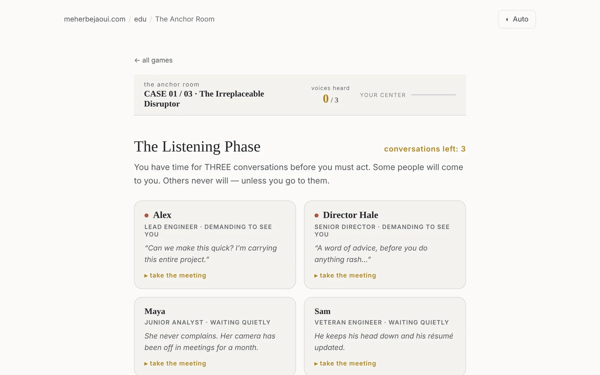
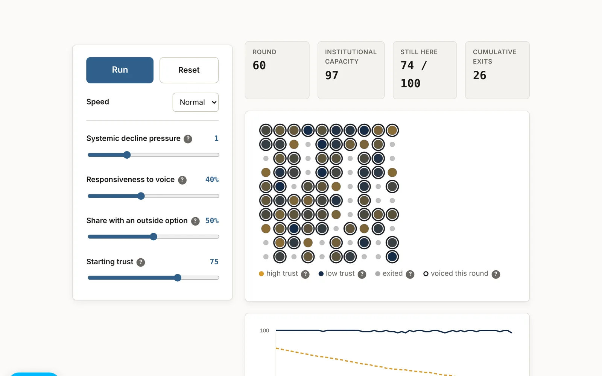
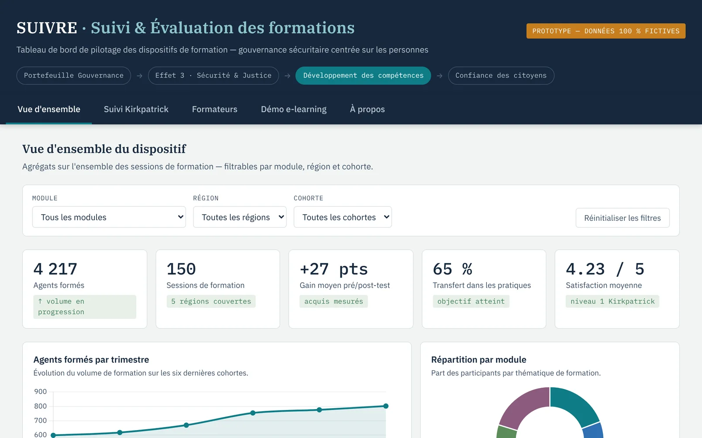
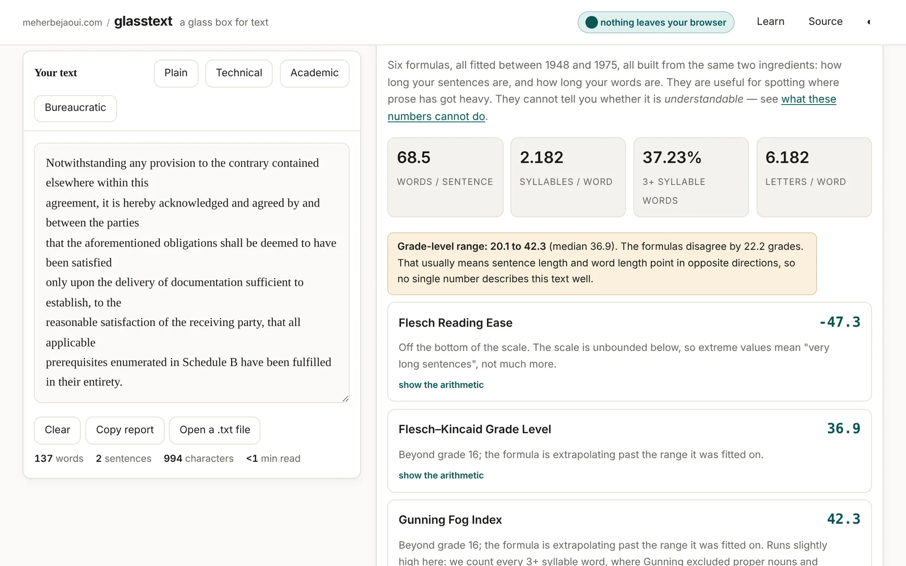
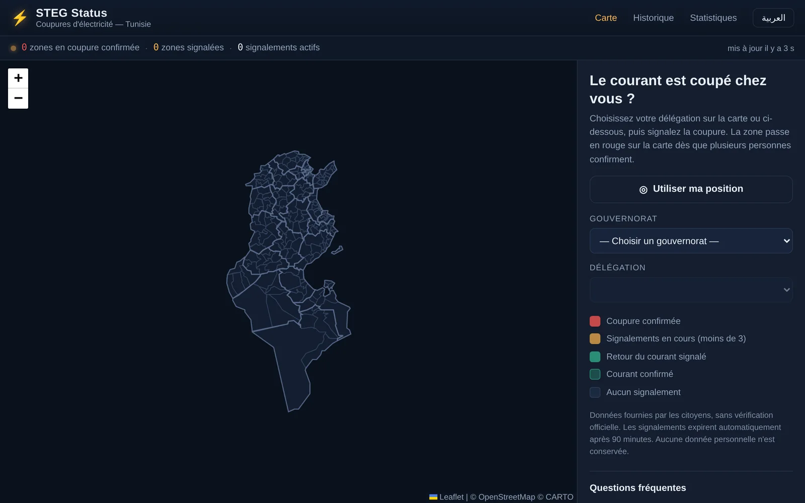
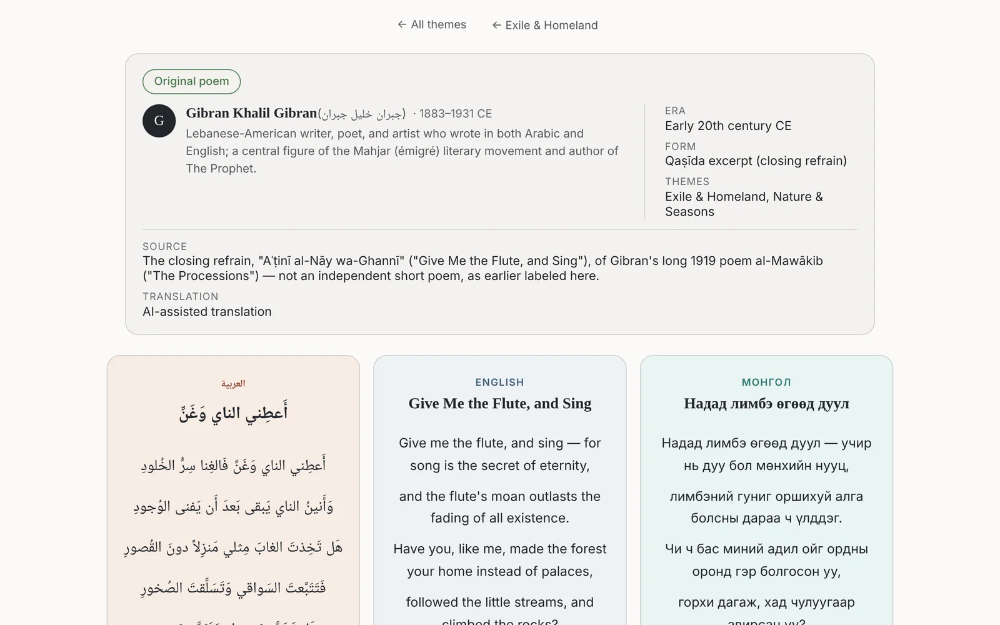
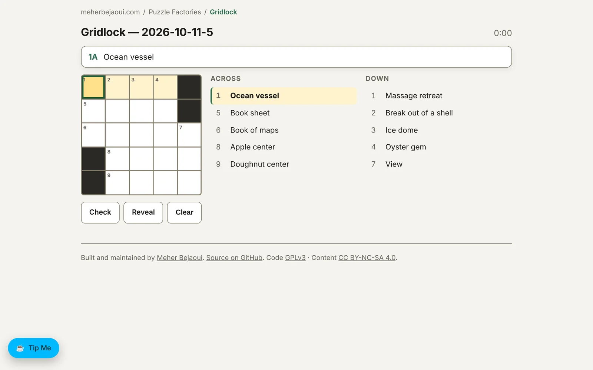



Some of what I build does not fit into an article. This page collects seven of those projects. Each one runs in the browser at its own address, and each is described below with a screenshot and a link.

## Edu: games about decisions under pressure

Edu holds two text-based games about the choices people make when every option costs someone.

**The Anchor Room** puts you inside eleven public decisions, grouped into three packs. You might be a team lead in a public research department, a mayor, the director of a regional water authority, or the president of a nurses' union. Each case gives you a brief and time for only three conversations. The loud voices come to you. The quiet ones speak only if you go to them. Then a private message arrives from someone with power over you, and you decide. You read how two different rooms describe your decision, face the people you did not choose, and see what happened later. A debrief names the pushes that moved you, the anchors that held you, and the people you never heard.

**The Interpreter** has three cases of about ten minutes each: two co-founders dissolving their company, the sale of a local firm's process to a foreign buyer, and two brothers at their mother's table. They no longer speak to each other directly, so every line passes through you, and you choose among three unlabeled ways to carry it across.

Neither game has a right answer.

Play the games

## Institutions: why capable people leave, or fall silent

Institutions is three interactive pieces built around one question. Inside an institution that is visibly declining, why does decision-making stall, and can the spiral of exit and silence be interrupted before it removes the capacity needed to fix it? The question comes out of roughly eight years in Tunisian public administration, five of them overseeing state-owned enterprises and public establishments from the Presidency of the Government.

- **The Decline Spiral** is an agent-based simulation. A hundred people each hold a depletable account of trust. As it drains, those with the best outside options leave first, and each departure removes capacity the institution needed to correct course. Four sliders set the decline pressure, how far voice is heard, how many people have somewhere else to go, and the starting level of trust.
- **The In-Tray** is a playable desk. Dossiers arrive and you approve, refuse, or ask for further documents. The payoffs are hidden, and they reward deferral. At the end, your own choices are drawn as a deferral-chain timeline and a time-to-clearance chart.
- **The reading map** sets out five established explanations for why institutions fail to decide: non-decision-making, blame avoidance, implementation deficit, individual decision avoidance, and exit, voice, and loyalty.

The simulation and the game are illustrative models, not empirical findings, and the dossiers are synthetic. Every citation is checked against a verifiable source and listed in the project's references.

Explore the three pieces

## Suivre: monitoring and evaluation of training

Suivre is a French-language dashboard that shows what a monitoring and evaluation system for a training program can look like. Its setting is people-centered security governance, where officers are trained in subjects such as professional ethics and the reception of citizens. All of the figures, names, and scenarios are fictitious and were generated for the demonstration.

It has four working parts:

- an overview of agents trained per quarter, the split by module, and regional coverage, filterable by module, region, and cohort;
- follow-up on the Kirkpatrick model, covering participant satisfaction, learning gains between pre-test and post-test, and transfer into practice three months later;
- quality control of trainers, through session observation grids and a five-criterion competency profile;
- an interactive e-learning case with immediate feedback and a log of each attempt.

The idea behind the tool is that the value of training is measured by what changes for the citizen who meets the trained officer. That is why the dashboard gives transfer into practice more weight than satisfaction scores. It is a single static page with no server and no data collection.

Open the dashboard

## Glasstext: a glass box for text

Most readability tools hand over a number and stop. Glasstext shows where each number comes from. Paste English prose, and every metric can be expanded to show the exact arithmetic, the counts that went in, the paper it comes from, and the cases where it breaks.

It covers five areas:

- **Readability:** six classic formulas (Flesch Reading Ease, Flesch–Kincaid, Gunning Fog, SMOG, Coleman–Liau, and ARI), with a flag when they disagree.
- **Vocabulary:** type-token ratio, MATTR, MTLD, Herdan's C, and words used only once.
- **Style:** sentence-length rhythm, passive-voice candidates, nominalizations, and hedges.
- **Distribution:** Zipf and Heaps curves, which explain why vocabulary measures depend on the length of the text.
- **Filter lab:** why naive word filters block innocent words, known as the Scunthorpe problem.

Two design choices matter most. The page's content security policy blocks all network requests, so the text you paste cannot leave your browser. And the tool measures its own weak points: its syllable counter agrees exactly with the CMU Pronouncing Dictionary on about 92% of 117,486 words, and that figure is published along with its errors. A separate Learn page explains what these numbers cannot tell you.

Open the tool

## STEG Status: a crowdsourced outage map for Tunisia

STEG Status works like Downdetector for the power grid. When the electricity goes out, a resident picks their delegation on the map, or lets the site use their location, and reports the outage with one button. The map covers all 24 governorates and 264 delegations of Tunisia, in French and Arabic.

A single report does not turn a zone red. The first reports show it in orange, and it becomes a confirmed outage only once enough different people have reported the same zone. Reports expire after 90 minutes, so the map clears by itself when people stop reporting, and residents can also report that power is back. History and statistics pages show recent outages and the zones most affected.

The site never stores IP addresses. It keeps only a salted hash, with a salt that changes every day, which is enough to stop one person from reporting many times.

It is an independent citizen project with no link to STEG, the national electricity and gas company, and it says so on the page. The data comes only from visitors' reports and is not officially verified.

View the map

## Poetry: Arabic, English, and Mongolian side by side

Poetry is a reader for classical and modern poems in three languages at once. You pick one of eight themes, such as love and longing, exile and homeland, or time and mortality, and a poem appears in three columns: Arabic, English, and Mongolian in Cyrillic script.

The collection holds more than 80 poems by over 30 poets. About half were written in Arabic, from the pre-Islamic poet ʿAntarah through al-Mutanabbī and Ibn Zaydūn to Ahmed Shawqi and Gibran. The rest were written in English, from Shakespeare and Blake to Dickinson and Yeats.

Each poem carries its metadata: the poet and a short biography, the era, the form, and a source note. The notes say when a text is an excerpt and when its attribution is disputed.

Two things are stated openly on the site. The translations are AI-assisted reading aids, not the work of a professional literary translator. And a separate set of AI-generated poems sits beside the originals. Each of those carries an "AI Generated" badge, and you choose between an original poem and an AI-generated one before reading.

Read the poems

## Puzzle Factories: two daily puzzles

Puzzle Factories publishes two new puzzles every day. Each is made by a small program and checked by that program before it goes out.

**Gridlock** is a 5×5 mini crossword. Filling a small, fully interlocked grid is the hard part of making a crossword, and Gridlock does it with a backtracking constraint-satisfaction search over a curated list of more than 2,500 clued words.

**Cellblock** is a 10×10 nonogram, the logic puzzle where numbers beside each row and column reveal a hidden picture. Any picture can be turned into a nonogram, but most produce a puzzle that forces a guess. Cellblock generates candidate pictures and keeps only those its solver can finish by logic alone, which also proves that the solution is unique. It grades each puzzle easy, medium, or hard, and it adds a gallery of twelve hand-drawn pixel-art puzzles.

Both puzzles are seeded by the date, so everyone gets the same one on the same day, and the site rebuilds itself daily just after midnight UTC. Every past puzzle stays in an archive to replay. The players offer check and reveal, a timer, and saved progress, and they run entirely in the browser with no accounts and no server.

Play the puzzles

The source code for all seven projects is public on [GitHub](https://github.com/meherbejaoui).
